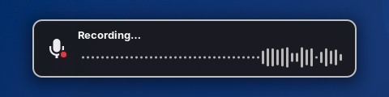
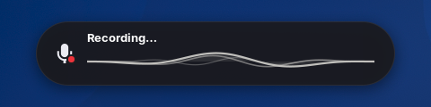
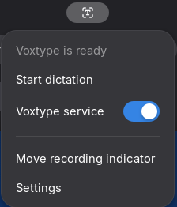
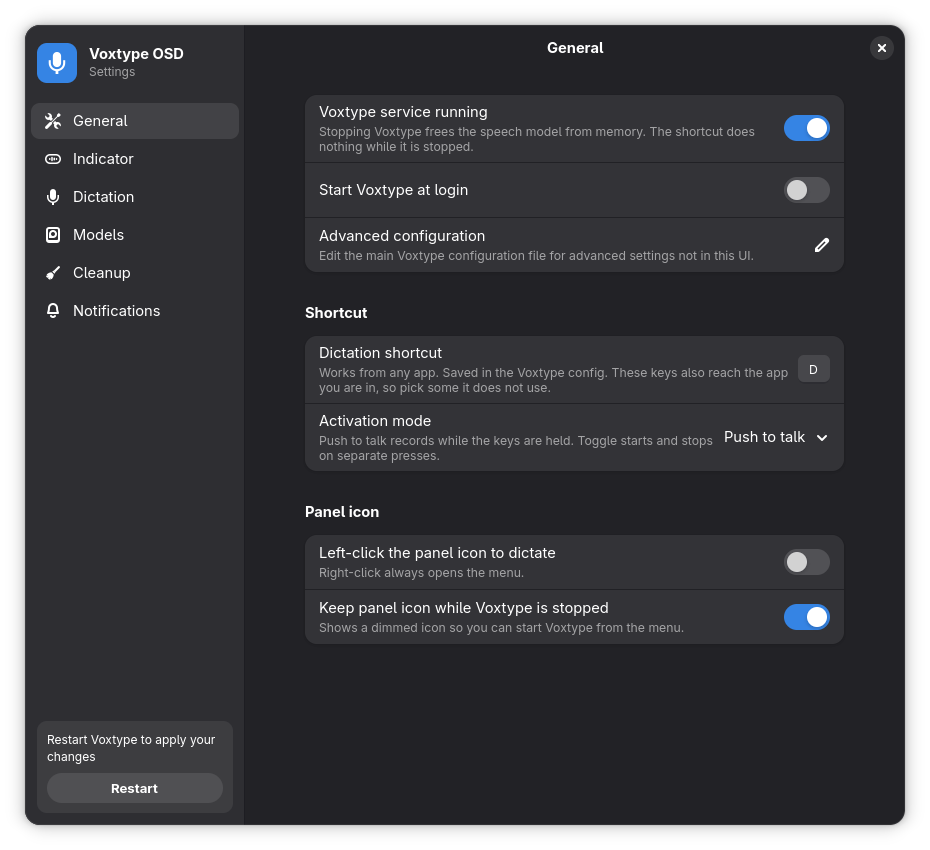
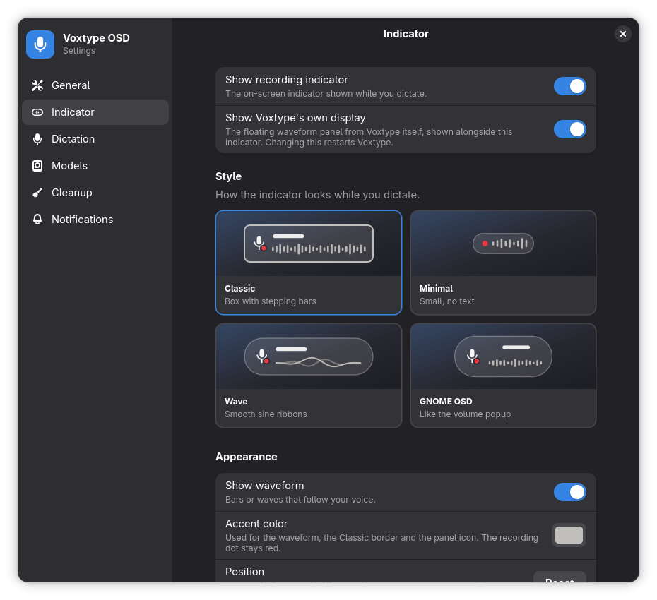
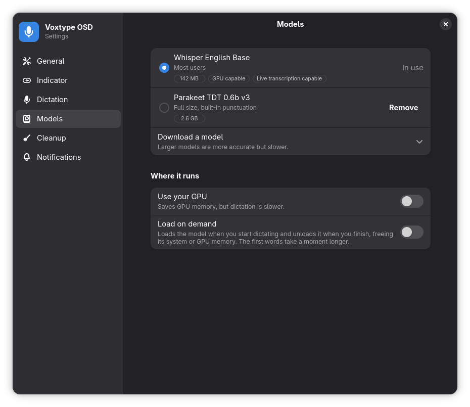
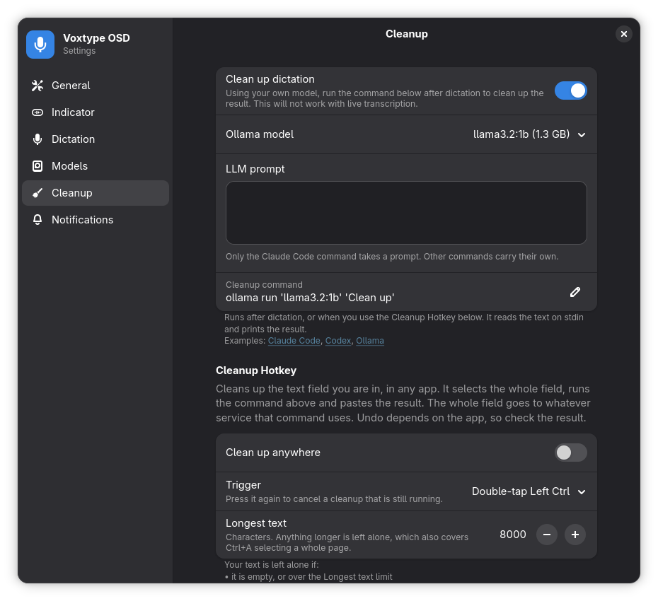

# Voxtype OSD

A GNOME Shell 51 extension for the [voxtype](https://github.com/peteonrails/voxtype) speech-to-text
daemon. It shows when you are dictating, puts voxtype's settings in one window, and can clean up the
text in any app.

| Classic | Minimal |
| :-: | :-: |
|  |  |
| **Wave** | **GNOME OSD** |
|  |  |

## Features



- **Recording indicator:** follows your voice in one of four styles. A red dot means the mic is live.
  Drag it anywhere.
- **Panel menu:** see the status, start dictation, and start or stop the voxtype service. Left click
  can start and stop dictation instead.
- **Settings:** the shortcut, microphone, notifications and more, without editing voxtype's config.
- **Models:** download, compare and switch models. The extension sets up the voxtype build each one
  needs, and asks for your password when it has to.
- **Text cleanup:** runs dictated text through a command, such as an Ollama model or your installed
  Claude Code or Codex.
- **Cleanup Hotkey:** cleans up the text field you are in, in any app.

<br clear="right">

| General | Indicator |
| :-: | :-: |
|  |  |
| **Models** | **Cleanup** |
|  |  |

Open Settings from the panel menu, or with `gnome-extensions prefs voxtype-osd@theoodawara`.

## Cleanup Hotkey

Off by default. Turn it on from the Cleanup page, then double tap Left Ctrl or press your own shortcut.
It selects the whole field, runs your cleanup command, pastes the result and puts your clipboard back.
Press the trigger again to cancel. Undo depends on the app, so don't count on Ctrl+Z.

- The whole field goes to whatever service your command uses.
- Your text is left alone if the command fails, the field changes or you move to another window.
- Terminals are skipped, but a terminal inside another app, like VS Code's, can't be detected.
- Rich text on your clipboard comes back as plain text.

The Claude Code example runs with every tool off and rejects replies that are more than a light edit.
It can't judge meaning, so read the result before you send it. The other commands have no such checks.
The Codex example can't change files, but Codex can't turn its tools off, so text you clean up could
trick it into reading files and pasting out what it finds.

## Requirements

- GNOME Shell 51
- voxtype running as a systemd user service
- Membership of the `input` group, for voxtype's hotkey
- `voxtype-audio-bridge` on `PATH`, which ships with voxtype

Live transcription needs a GPU to keep up.

## Install

```sh
npm ci
npm run install-extension
gnome-extensions enable voxtype-osd@theoodawara
```

Log out and back in for GNOME Shell to load it. To build a zip instead, run `npm run pack`.

## Development

```sh
npm test            # type check and unit tests
npm run test:shell  # the extension in a real, headless GNOME Shell, about 90 seconds
```

The shell tests run in their own session, so your desktop isn't touched. Set
`VOXTYPE_OSD_SCREENSHOTS=<dir>` to save the screenshots used here.
