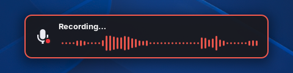
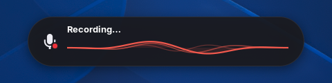
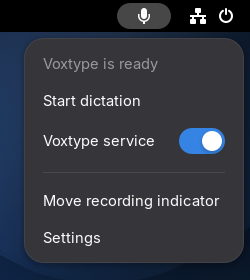
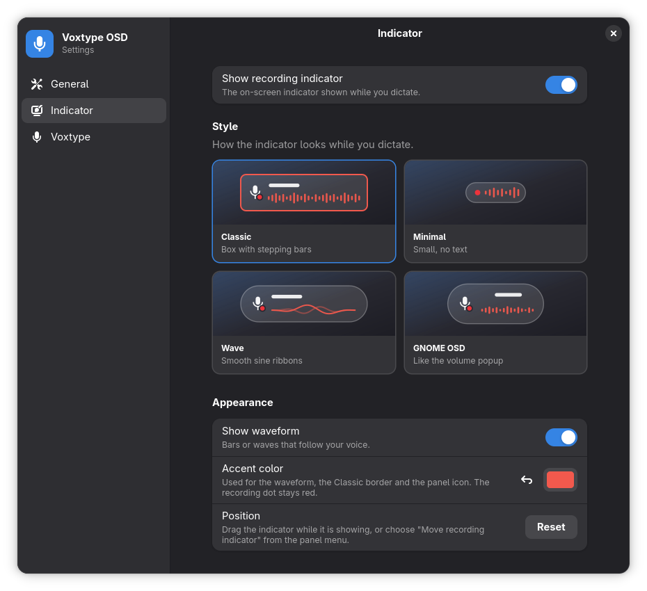

# Voxtype OSD

GNOME Shell 50/51 extension for the [voxtype](https://github.com/peteonrails/voxtype) speech-to-text
daemon: a panel indicator for its state, an on-screen pill with a live waveform while it records, a
panel menu to control the voxtype service, and a settings window.

## Features

**Recording indicator:** an on-screen pill that follows your voice while you dictate, in one of four
styles. A red dot on the microphone means it is live. It reads "Recording…" while recording and
"Transcribing…" while voxtype transcribes, which with live dictation (`[parakeet] streaming`) is
already the case while you speak. Drag it to move it; the position is remembered.

| Classic | Minimal |
| :-: | :-: |
|  |  |
| **Wave** | **GNOME OSD** |
|  |  |



**Panel icon:** the accent color while dictating or transcribing, and a dimmed crossed-out microphone
while the voxtype service is stopped. Left click starts and stops dictation (can be turned off). Right
click opens a menu with the current status, start/stop dictation, a switch for the voxtype service,
"Move recording indicator" (shows the indicator for 20 seconds so it can be dragged) and Settings.

<br clear="right">

**Settings window** (`gnome-extensions prefs voxtype-osd@theoodawara`):

- **General:** run voxtype now / at login, the dictation shortcut, and how the panel icon behaves.
- **Indicator:** show or hide the indicator, its style, the waveform, the accent color and its position.
- **Voxtype:** a curated set of voxtype's own options (live typing, delivery mode, input device, max
  recording length, media pausing, sound cues, notifications, on-demand model loading). Labels,
  descriptions, types and ranges come from `voxtype config schema --json`; changes are written with
  `voxtype config set`, and a banner offers to restart voxtype when a change needs it.

<p align="center">
  
</p>

## How it works

- **State:** watches `$XDG_RUNTIME_DIR/voxtype/state` with a `Gio.FileMonitor` and maps it to
  `idle`, `recording`, `streaming` (recording with live dictation), `transcribing` or
  `unavailable`. voxtype deletes the file when the daemon stops, which is how "stopped" is detected.
- **Waveform:** while recording, launches `voxtype-audio-bridge` as a subprocess and reads one JSON line
  per sample (`{"peak": 0.42}`) from its stdout. Classic keeps the loudest peak of each 100 ms as one
  bar; the other styles follow the latest peaks and a smoothed level. Malformed lines are dropped.
- **Service control:** starts, stops, enables and disables `voxtype.service` through the systemd user
  manager's D-Bus API (`org.freedesktop.systemd1`), the same calls `systemctl --user` makes.
- **Shortcut:** stored as a regular GNOME custom keyboard shortcut whose command is
  `voxtype record toggle`, so it keeps working even if the extension is disabled. The settings window
  edits that shortcut, or creates it if it is missing.
- The subprocess and the file monitor are cancelled on `disable()`, so nothing outlives the extension.

## Requirements

- GNOME Shell 50 or 51
- voxtype running as a systemd user service (`voxtype.service`)
- `voxtype-audio-bridge` on `PATH` (shipped with voxtype)

## Install

```sh
npm ci
npm run install-extension
gnome-extensions enable voxtype-osd@theoodawara
```

Log out and back in on Wayland for GNOME Shell to load it.

To build a zip for `gnome-extensions install`:

```sh
npm run pack    # writes dist/voxtype-osd@theoodawara.shell-extension.zip
```

## Development

```sh
npm run build
npm test            # type check and unit tests, about a second
npm run test:shell  # the extension in a real, headless GNOME Shell, about 25 seconds
```

`npm test` covers the pure logic: parsing voxtype's state file and audio levels, the bars and
waveforms, accent colors, the Voxtype page's dropdowns, and the settings schema. It runs on every push.

`npm run test:shell` needs `gnome-shell` installed. It starts a headless GNOME Shell with its own D-Bus
session, settings and runtime directory, so your desktop is not touched, and swaps `voxtype`,
`systemctl` and `voxtype-audio-bridge` for scripts that record every call. It then checks a full
dictation, live dictation, every style, live settings changes, the panel menu, that voxtype is never
started or stopped on its own, clean disable/enable, and that each Settings page opens without errors.
Set `VOXTYPE_OSD_SCREENSHOTS=<dir>` to also save screenshots of each style and Settings page.
